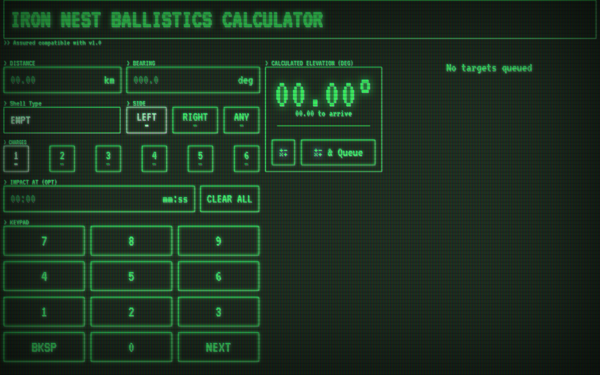

# Iron Nest Ballistics Calculator



A static, single-page ballistics calculator for **Iron Nest**. Enter distance,
bearing, shell type and charge count to get the required elevation angle and
time-to-target, and keep a target queue. Everything runs in the browser —
no backend, no build step.

**Live:** https://busybin.github.io/iron-nest-ballistics-calculator/

## Features

- Distance (0–30 km), bearing (0–360°), shell type (21 entries), charges (1–6)
- Elevation + time-to-target, with an animated readout
- Target queue with move up/down, delete and dim
- On-screen keypad (no soft keyboard needed)
- Retro CRT-green theme, scaled to fit the viewport

## Run locally

Just open `index.html`, or serve the folder:

```sh
npx serve .
```

## Deploy

GitHub Pages — source branch `main`, folder `/`.

## Credits

- **Original:** the Iron Nest calculator by the author of
  [iron-nest.shiru.dog](https://iron-nest.shiru.dog/). The visual design and the
  ballistics model are theirs; this repository is an **unofficial
  reimplementation** and is not affiliated with or endorsed by the original
  author.
- **Font:** [VT323](https://fonts.google.com/specimen/VT323) by Peter Hull
  (SIL Open Font License 1.1).

## Disclaimer

Unofficial fan project, provided "as is", for the game *Iron Nest*. No warranty.

## Author

busybin — https://github.com/busybin
